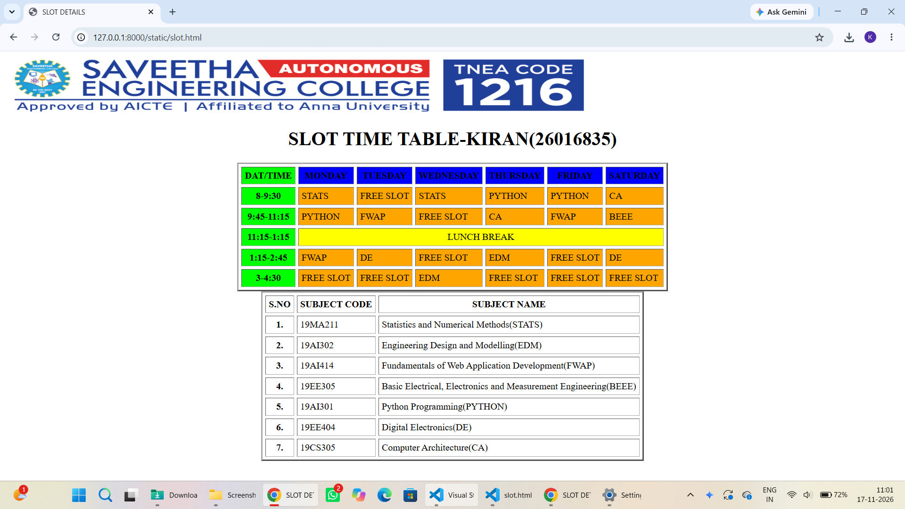

# Ex02 Time Table
## Date:17/11/2026

## AIM
To write a html webpage page to display your slot timetable.

## ALGORITHM
### STEP 1
Create a Django-admin Interface.

### STEP 2
Create an App inside the Django project.

### STEP 2
Create a static folder uder the created App and insert HTML code.

### STEP 3
Create a simple table using ```<table>``` tag in html with the relevant attributes.

### STEP 4
Add rows using ```<tr>``` tag.

### STEP 5
Add your course schedule using ```<td>``` tag.

### STEP 6
Execute the program using runserver command.

## PROGRAM
```
<html>
    <head>
        <title>SLOT DETAILS</title>
    </head>
    <body>
        
        <table border="3" cellspacing="5" cellpadding="5" align="center">
        <caption><h1>SLOT TIME TABLE-KIRAN(26016835)</h1></caption>   
        <tr>
            <th bgcolor="lime">DAT/TIME</th>
            <th bgcolor="blue">MONDAY</th>
            <th bgcolor="blue">TUESDAY</th>
            <th bgcolor="blue">WEDNESDAY</th> 
            <th bgcolor="blue">THURSDAY</th>
            <th bgcolor="blue">FRIDAY</th>
            <th bgcolor="blue">SATURDAY</th>
        
        </tr>  
        <tr>
            <th bgcolor="lime">8-9:30</th>
            <td bgcolor="orange">STATS</td>
            <td bgcolor="orange">FREE SLOT</td>
            <td bgcolor="orange">STATS</td>
            <td bgcolor="orange">PYTHON</td>
            <td bgcolor="orange">PYTHON</td>
            <td bgcolor="orange">CA</td>
        </tr> 
        <tr>
            <th bgcolor="lime">9:45-11:15</th>
            <td bgcolor="orange">PYTHON</td>
            <td bgcolor="orange">FWAP</td>
            <td bgcolor="orange">FREE SLOT</td>
            <td bgcolor="orange">CA</td>
            <td bgcolor="orange">FWAP</td>
            <td bgcolor="orange">BEEE</td>
        </tr>
        <tr>
             <th bgcolor="lime">11:15-1:15</th>
             <td bgcolor="yellow"  colspan="6" align="center">LUNCH BREAK</td>
          

        </tr>
        <tr>
             <th bgcolor="lime">1:15-2:45</th>
             <td bgcolor="orange">FWAP</td>
             <td bgcolor="orange">DE</td>
             <td bgcolor="orange">FREE SLOT</td>
             <td bgcolor="orange">EDM</td>
             <td bgcolor="orange">FREE SLOT</td>
             <td bgcolor="orange">DE</td>

        </tr>
        <tr>
             <th bgcolor="lime">3-4:30</th>
             <td bgcolor="orange">FREE SLOT</td>
             <td bgcolor="orange">FREE SLOT</td>
             <td bgcolor="orange">EDM</td>
             <td bgcolor="orange">FREE SLOT</td>
             <td bgcolor="orange">FREE SLOT</td>
             <td bgcolor="orange">FREE SLOT</td>

        </tr>
        </table>
        <table border="3" cellspacing="5" cellpadding="5" align="center">
            <tr>
             <th>S.NO</th>
             <th>SUBJECT CODE</th>
             <th>SUBJECT NAME</th>
           
            </tr>
            <tr>
             <th>1.</th>
             <td>19MA211</td>
             <td>Statistics and Numerical Methods(STATS)</td>
            </tr>
            <tr>
             <th>2.</th>
             <td>19AI302</td>
             <td> Engineering Design and Modelling(EDM)</td>
            </tr>
            <tr>
             <th>3.</th>
             <td>19AI414</td>
             <td>Fundamentals of Web Application Development(FWAP)</td>
            </tr>
            <tr>
             <th>4.</th>
             <td>19EE305</td>
             <td>Basic Electrical, Electronics and Measurement Engineering(BEEE)</td>
            </tr>

            <tr>
             <th>5.</th>
             <td>19AI301 </td>
             <td>Python Programming(PYTHON)</td>
            </tr>
            <tr>
             <th>6.</th>
             <td>19EE404</td>
             <td>Digital Electronics(DE)</td>
            </tr>
            <tr>
             <th>7.</th>
             <td>19CS305 </td>
             <td>Computer Architecture(CA)</td>
            </tr>
        </table>
    </body>

</html>
```


## OUTPUT




## RESULT
The program for creating slot timetable using basic HTML tags is executed successfully.
